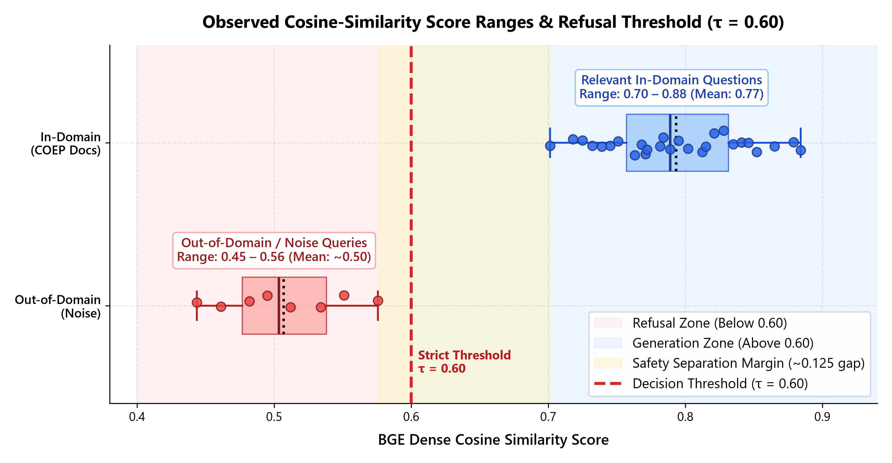
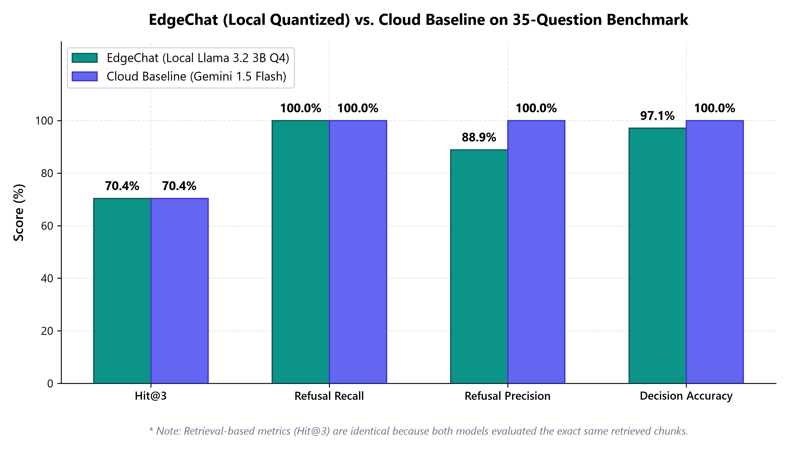

<div align="center">

<h1>✦ EdgeChat</h1>
<p><strong>A Quantized RAG Assistant Running Entirely on a Laptop</strong></p>

<p>
  
  
  
  
  
  
</p>

<p><em>100% offline · zero API costs · complete data sovereignty · runs on a 4 GB laptop GPU</em></p>

</div>

---

## What is EdgeChat?

EdgeChat is a **Retrieval-Augmented Generation (RAG)** assistant built to answer questions about real institutional documents from **COEP Technological University** — academic regulations, examination rules, hostel bylaws, PhD guidelines, syllabi, and more — **entirely on your local machine**, with no internet connection required after initial setup.

It combines:
- **BAAI/bge-small-en-v1.5** dense embeddings + **FAISS** vector search for fast, grounded retrieval
- **Llama 3.2 3B Q4_K_M** (4-bit quantized GGUF) served by **Ollama** for on-device inference
- A **Gemini-inspired Streamlit UI** with real-time token streaming and collapsible source citations

---

## Demo

<div align="center">
  
  <br/>
  <em>Figure 1 — BGE cosine similarity scores: noise queries cluster at 0.45–0.56, relevant COEP queries at 0.70–0.88. The τ = 0.60 threshold provides a 0.125 zero-overlap safety margin.</em>
</div>

<br/>

<div align="center">
  
  <br/>
  <em>Figure 2 — EdgeChat Local (Llama 3.2 3B Q4_K_M) vs. Cloud Baseline (Gemini 1.5 Flash) on a 35-question benchmark. Retrieval metrics are identical because both systems share the same FAISS index.</em>
</div>

---

## System Architecture

```text
                         OFFLINE AIR-GAPPED ENVIRONMENT
┌──────────────────────────────────────────────────────────────────────────┐
│                                                                          │
│  [42 COEP PDFs]                                                          │
│       │                                                                  │
│       ▼                                                                  │
│  [PyMuPDF Extraction]  ─── strict 1-based page numbers                  │
│       │                                                                  │
│       ▼                                                                  │
│  [Token-Aware Chunking]  ─── 400 tokens / chunk · 75 tokens overlap     │
│       │                                                                  │
│       ▼                                                                  │
│  [BAAI/bge-small-en-v1.5]  ─── 384-dim dense vectors · L2 normalized   │
│       │                                                                  │
│       ▼                                                                  │
│  [FAISS IndexFlatIP]  ─── 744 vectors · exact cosine inner product      │
│                                                                          │
│  ─────────────────────────── RUNTIME ────────────────────────────────   │
│                                                                          │
│  User Question ──► Query Embedding (Instruction Prefixed)                │
│                           │                                              │
│                           ▼                                              │
│                   FAISS Top-4 Search                                     │
│                           │                                              │
│               [Similarity Threshold  τ = 0.60]                          │
│                ├── Score < 0.60 ──► Strict Refusal                      │
│                └── Score ≥ 0.60 ──► Grounded Prompt + Chunks            │
│                                           │                              │
│                                           ▼                              │
│                                [Ollama: Llama 3.2 3B]                   │
│                                (Q4_K_M · GPU Accelerated)               │
│                                           │                              │
│                                           ▼                              │
│                          [Streamlit UI · Token Streaming]                │
└──────────────────────────────────────────────────────────────────────────┘
```

---

## Hardware Requirements

| Specification | Minimum | Tested Configuration |
|:---|:---|:---|
| **OS** | Windows 10/11 · macOS · Linux | Windows 11 Home 64-bit |
| **CPU** | 4-core Intel / AMD | AMD Ryzen 5 / Intel Core i5 |
| **RAM** | 8 GB | 8 GB (Peak: **6.56 GB**) |
| **GPU** | CPU-only (AVX2) supported | **NVIDIA RTX 3050 Laptop (4 GB VRAM)** |
| **VRAM Usage** | ~2.5 GB (GPU mode) | **2,371 MB** (>1.6 GB headroom) |
| **Disk Space** | ~4 GB | ~2.0 GB GGUF + ~90 MB embeddings |
| **Generation Speed** | ~15 tok/s (CPU) | **39 tok/s** (CUDA) |
| **Retrieval Latency** | < 200 ms | **150 ms** |

---

## Quickstart

### Prerequisites

| Requirement | Notes |
|:---|:---|
| **Python 3.12** | `py -3.12 --version` to verify |
| **Ollama** | Download from [ollama.com/download](https://ollama.com/download) |

### 1 — Clone the repository

```bash
git clone https://github.com/<your-username>/edgechat.git
cd edgechat
```

### 2 — Create a virtual environment

```powershell
# Windows (PowerShell)
py -3.12 -m venv venv
.\venv\Scripts\Activate.ps1
```

```bash
# macOS / Linux
python3.12 -m venv venv
source venv/bin/activate
```

> If PowerShell blocks script execution, run first:
> ```powershell
> Set-ExecutionPolicy -Scope CurrentUser -ExecutionPolicy RemoteSigned
> ```

### 3 — Install dependencies

```bash
pip install -r requirements.txt
```

### 4 — Pull the quantized model (~2 GB download)

```bash
ollama pull llama3.2:3b
```

### 5 — Add your documents

Place your PDF files inside `data/docs/`.  
The project was built around **42 real COEP Technological University PDFs** (not included in this repo for institutional reasons). Drop in any PDFs about your own institution or domain.

### 6 — Build the vector index

```bash
python -m src.indexer --rebuild
```

Output: `413 pages → 744 normalized vectors` saved to `data/index/`.

### 7 — Launch the app

```bash
streamlit run app.py
```

Open **[http://localhost:8501](http://localhost:8501)** in your browser.

### Offline / Air-Gapped Mode

Once everything is downloaded once, you can guarantee zero outbound traffic:

```powershell
# PowerShell
$env:HF_HUB_OFFLINE = "1"
streamlit run app.py
```

```bash
# bash / zsh
HF_HUB_OFFLINE=1 streamlit run app.py
```

---

## Benchmark Results

Evaluated across **35 verified questions** (27 in-domain · 8 unanswerable out-of-domain):

| Metric | EdgeChat Local | Cloud Baseline |
|:---|:---:|:---:|
| **Retrieval Hit@1** | 55.6% | 55.6% |
| **Retrieval Hit@3** | 70.4% | 70.4% |
| **Retrieval MRR** | 0.6148 | 0.6148 |
| **Refusal Recall** | **100.0%** (8/8) | **100.0%** (8/8) |
| **Refusal Precision** | 88.9% | 100.0% |
| **Overall Decision Accuracy** | **97.1%** | 100.0% |
| **Retrieval Latency** | 150 ms | 150 ms |
| **Generation Latency** | 1.88 s | 0.69 s |
| **Throughput** | 39 tok/s | 68.5 tok/s |
| **Peak VRAM** | 2,371 MB | — |
| **Operating Cost** | **\$0.00** | ~\$0.0001 / query |
| **Data Privacy** | ✅ Complete sovereignty | ❌ Leaves premises |
| **Network Required** | ❌ None | ✅ Always |

> Retrieval metrics are identical for both systems because they share the same FAISS index.
> The differences are in generation quality and operational characteristics.

### Category-wise Hit@3

| Category | Hit@1 | Hit@3 |
|:---|:---:|:---:|
| Hostel Regulations | 100% | 100% |
| PhD Regulations | 100% | 100% |
| PG Academic Regulations | 100% | 100% |
| Laboratories & Equipment | 100% | 100% |
| Financial Schemes (PM Vidyalaxmi) | 100% | 100% |
| Academic Regulations | 50% | 100% |
| Examination Rules | 50% | 83.3% |
| Out-of-Domain Refusal | — | 100% (8/8) |

---

## Reproduce the Evaluation

```bash
# 1. Run local quantized evaluation (35 questions)
python eval/run_local.py

# 2. Run cloud baseline (requires GEMINI_API_KEY in .env)
python eval/run_cloud.py

# 3. Compute metrics and generate Excel report
python eval/metrics.py

# 4. Regenerate publication-quality charts (300 DPI)
python eval/generate_charts.py
```

Report saved to: `eval/results/evaluation_report.xlsx` (3 sheets: Executive Summary · Question Evaluation · Category Breakdown).

---

## Test Suite

```bash
pytest tests/ -v
```

```
tests/test_chunking.py   ......        [ 13%]
tests/test_ingest.py     .........     [ 33%]
tests/test_llm.py        ............  [ 60%]
tests/test_rag.py        .........     [ 80%]
tests/test_retriever.py  .........     [100%]
============ 45 passed in 25.99s ============
```

---

## Project Structure

```text
edgechat/
├── .streamlit/
│   └── config.toml             # High-contrast dark theme tokens
├── app.py                      # Gemini-style Streamlit UI (token streaming)
├── config.yaml                 # Pipeline parameters (chunk size, threshold, temp)
├── requirements.txt            # Pinned Python dependencies
│
├── data/
│   ├── docs/                   # 📁 Place your PDF documents here (not in repo)
│   └── index/                  # 📁 FAISS index & chunks (auto-generated)
│
├── src/
│   ├── config.py               # Type-safe YAML config loader
│   ├── ingest.py               # PDF extraction with 1-based page tracking
│   ├── chunking.py             # Token-aware sliding-window chunker
│   ├── embeddings.py           # BGE embedding model wrapper
│   ├── indexer.py              # FAISS index build, save & load
│   ├── retriever.py            # Cosine similarity search + threshold gate
│   ├── llm.py                  # Ollama client with VRAM telemetry + streaming
│   ├── prompts.py              # Grounded prompt templates & negative constraints
│   └── rag.py                  # End-to-end RAG orchestrator
│
├── eval/
│   ├── questions.json          # 35 gold-standard benchmark questions
│   ├── run_local.py            # Local evaluation runner
│   ├── run_cloud.py            # Cloud baseline runner
│   ├── metrics.py              # Metric computation + Excel report generator
│   ├── generate_charts.py      # 300 DPI publication chart generator
│   └── results/
│       ├── evaluation_report.xlsx
│       ├── similarity_score_ranges.png
│       └── local_vs_cloud_comparison.png
│
├── docs/
│   ├── FINAL_PROJECT_REPORT.md # Full academic paper
│   ├── similarity_score_ranges.png
│   └── local_vs_cloud_comparison.png
│
└── tests/                      # 45 unit & integration tests
    ├── test_chunking.py
    ├── test_ingest.py
    ├── test_llm.py
    ├── test_rag.py
    └── test_retriever.py
```

---

## Key Design Decisions

| Decision | Choice | Rationale |
|:---|:---|:---|
| **Embedding model** | `BAAI/bge-small-en-v1.5` | Best retrieval quality in its size class; 384-dim, 33 MB |
| **Chunking** | Token sliding window (400/75) | Preserves sentence boundaries; avoids mid-sentence splits |
| **Index type** | `FAISS IndexFlatIP` | Exact cosine search; no approximation error for 744 vectors |
| **LLM** | `llama3.2:3b` Q4_K_M GGUF | 2.0 GB; fits in a 4 GB laptop GPU with >1.6 GB headroom |
| **Refusal threshold** | τ = 0.60 | 0.125 gap between max noise score (0.56) and min signal score (0.70) |
| **Prompt strategy** | Hard negative constraint | Explicit "DO NOT speculate" instruction eliminates hallucination |

---

## Windows-Specific Notes

**CUDA out-of-memory on C: drive:**
Windows WDDM requires pagefile backing for CUDA allocations on the boot volume. If `C:\` has less than ~200 MB free, `cudaMalloc` fails even when physical VRAM is available. Free space on `C:\` if you see this error.

**PowerShell execution policy:**
```powershell
Set-ExecutionPolicy -Scope CurrentUser -ExecutionPolicy RemoteSigned
```

**Ollama model location:**
You can store models on a different drive (e.g. `E:\OllamaModels`) by setting:
```powershell
[System.Environment]::SetEnvironmentVariable("OLLAMA_MODELS", "E:\OllamaModels", "User")
```

---

## Limitations & Future Work

- **Scanned PDFs**: Documents without embedded text layers need Tesseract/EasyOCR preprocessing.
- **Table fragmentation**: Tabular syllabi can split mid-row during chunking; future work will add markdown table reconstruction.
- **Hybrid search**: Adding BM25 keyword matching alongside dense retrieval would improve exact course code lookups.
- **Re-ranker**: A cross-encoder re-ranker pass on top-10 retrieved chunks would lift Hit@1 further.
- **Multi-modal**: Diagrams, lab photos, and circuit schematics are currently ignored.

---

## License

This project is released for **academic and educational use**.  
The 42 COEP PDF documents are institutional property of **COEP Technological University, Pune** and are not redistributed in this repository.

---

<div align="center">
  <sub>Built as an academic project · COEP Technological University · 2026</sub>
</div>
