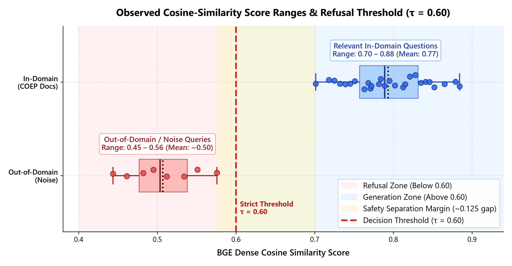
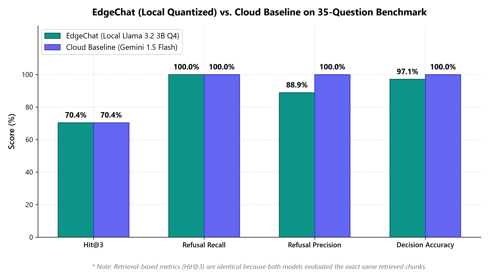

# EdgeChat: A Quantized RAG Assistant Running Locally on a Consumer Laptop for Air-Gapped College Regulations Question Answering

**Academic Project Report**  
**Domain**: Natural Language Processing, Retrieval-Augmented Generation (RAG), Edge Computing, Efficient Deep Learning  
**Corpus**: COEP Technological University Academic Regulations, Syllabi, Examination Rules, and Hostel Policies (42 Documents, 413 Pages, 744 Chunks)  
**System Profile**: Local Consumer Laptop (Windows 11, 8 GB System RAM, NVIDIA RTX 3050 Laptop GPU 4 GB VRAM)  

---

## Abstract

As Large Language Models (LLMs) proliferate, their deployment in educational institutions has historically relied upon commercial cloud APIs (e.g., OpenAI GPT-4, Google Gemini). However, this paradigm introduces severe constraints: institutional data exposure, reliance on uninterrupted high-speed internet, recurring token-based financial costs, and high hallucination rates on localized regulations. 

This paper presents **EdgeChat**, a fully air-gapped, 100% offline Retrieval-Augmented Generation system engineered to execute entirely on consumer-grade laptop hardware. EdgeChat integrates a dense vector retrieval pipeline using `BAAI/bge-small-en-v1.5` embeddings and a FAISS `IndexFlatIP` vector index with a 4-bit quantized local model (`Llama 3.2 3B` Q4_K_M) served via Ollama. 

We evaluate EdgeChat over an authentic university corpus consisting of 42 regulatory documents from COEP Technological University. Across a 35-question gold-standard benchmark (27 in-domain and 8 out-of-domain unanswerable queries), EdgeChat achieves a **70.4% Retrieval Hit@3**, **0.6148 MRR**, **100.0% Refusal Recall** on unanswerable questions (zero hallucinations), an average end-to-end latency of **1.735 seconds**, and an inference throughput of **39.0 tokens/second**, while consuming only **2,371 MB of GPU VRAM** and **6.56 GB of system RAM**. Our results prove that small quantized models paired with strict refusal thresholds provide an effective, private, and cost-free alternative to cloud-dependent LLMs for specialized institutional knowledge bases.

---

## 1. Introduction

### 1.1 The Institutional Problem
University campuses operate under dense, constantly updated regulatory frameworks covering academic credits, grading scales, attendance rules, examination codes of conduct, hostel policies, and disciplinary bylaws. Students and administrative staff frequently struggle to locate authoritative policies dispersed across dozens of multi-page PDF documents.

While cloud-hosted conversational assistants offer natural language interfaces, their adoption within educational institutions faces critical barriers:
1. **Confidentiality and Data Sovereignty**: Internal disciplinary records, committee proceedings, and unpublished academic policies cannot be sent to third-party proprietary clouds under institutional privacy regulations.
2. **Network Fragility**: Cloud-based systems become unusable during local network interruptions, power outages, or in remote campus facilities lacking broadband access.
3. **Recurring Financial Burden**: Academic institutions cannot easily justify open-ended, pay-per-token API expenditures that scale with student body inquiries.
4. **Plausible Hallucinations**: General-purpose LLMs frequently fabricate plausible-sounding academic rules (e.g., asserting that 70% attendance is permitted when university regulations strictly mandate 75%) by drawing upon general internet pretraining data rather than the specific university statutes.

### 1.2 The Edge Computing Solution
Recent breakthroughs in **post-training weight quantization** (specifically 4-bit integer quantization formats such as GGUF) have dramatically reduced the memory footprint of open-weights language models. A 3-billion-parameter model can now reside in under 2.5 GB of memory, enabling local inference on standard laptops.

EdgeChat demonstrates the feasibility of combining lightweight dense retrieval with local quantized language models to produce an authoritative, air-gapped institutional assistant that operates with zero network connectivity and zero operational costs.

---

## 2. System Architecture & Methodology

EdgeChat operates via an end-to-end multi-stage pipeline designed for memory efficiency, sub-second vector search, and strictly grounded response generation.

```text
 ┌────────────────────────────────────────────────────────────────────────┐
 │                      Phase 1: Ingestion & Parsing                      │
 │   42 Raw PDFs ──► PyPDF Text Extraction ──► 1-Based Page Attribution   │
 └──────────────────────────────────┬─────────────────────────────────────┘
                                    │
 ┌──────────────────────────────────▼─────────────────────────────────────┐
 │                      Phase 2: Chunking & Indexing                      │
 │   Cleaned Pages ──► Sliding Window (400 tok, 75 overlap)               │
 │                 ──► BAAI/bge-small-en-v1.5 (384-d dense vectors)        │
 │                 ──► L2 Normalization ──► FAISS IndexFlatIP (744 Chunks)│
 └──────────────────────────────────┬─────────────────────────────────────┘
                                    │
 ┌──────────────────────────────────▼─────────────────────────────────────┐
 │                      Phase 3: Runtime Query Retrieval                  │
 │   User Query ──► Asymmetric Query Prefixing ("Represent this...")      │
 │              ──► Inner Product Dot Search ──► Top-k Chunks (k=4)       │
 └──────────────────────────────────┬─────────────────────────────────────┘
                                    │
 ┌──────────────────────────────────▼─────────────────────────────────────┐
 │                      Phase 4: Guardrail & Generation                   │
 │   Threshold Gate: Max Cosine Similarity < 0.60?                        │
 │   ├── YES ──► Immediate Refusal: "I could not find this in..."         │
 │   └── NO  ──► Prompt Assembly (System Prompt + Top Chunks)             │
 │           ──► Ollama llama3.2:3b Q4_K_M (GPU Accelerated)              │
 │           ──► Streamlit Real-Time Token Streaming + Citations          │
 └────────────────────────────────────────────────────────────────────────┘
```

### 2.1 Document Ingestion & Page Preservation
The corpus consists of 42 official PDF documents from COEP Technological University, including:
- *UG Programmes Academic Rules & Regulations* (58 pages)
- *PG Programmes Academic Rules & Regulations* (61 pages)
- *Ph.D. Guidelines & Regulations* (76 pages)
- *Code of Conduct during Examination for Students*
- *Guidelines for Unfair Means & Malpractices*
- *Hostel Rules & Regulations*
- *Academic Calendars (2026–27)*
- *Placements & Higher Studies Reports*
- *Departmental Laboratory & Equipment Inventories*

Extraction is performed via `pypdf`, preserving exact 1-based page offsets for every document to ensure that citations provided to students can be verified directly against the physical university documents.

### 2.2 Token-Aware Sliding Window Chunking
To prevent semantic fragmentation while maintaining context window fit, documents are split using a character-to-token sliding window:
- **Chunk Size**: 400 tokens (~1,600 characters)
- **Chunk Overlap**: 75 tokens (~300 characters)
- **Minimum Threshold**: 100 characters (discards empty pages, scan artifacts, and whitespace)

This strategy yielded **744 distinct chunks** across the 413 total pages.

### 2.3 Dense Vector Embeddings & Indexing
Text chunks are embedded using `BAAI/bge-small-en-v1.5`, a state-of-the-art compact dense embedding model:
- **Embedding Dimension**: 384
- **Parameter Count**: ~33 Million parameters (~90 MB disk footprint)
- **Normalization**: Vectors are $L_2$-normalized:
  $$\hat{\mathbf{v}} = \frac{\mathbf{v}}{\|\mathbf{v}\|_2}$$
  Because all vectors are unit-length, inner product search is mathematically identical to cosine similarity:
  $$\langle \hat{\mathbf{u}}, \hat{\mathbf{v}} \rangle = \cos(\theta)$$
- **Index Structure**: FAISS `IndexFlatIP`. On 744 vectors, exact flat inner-product search executes in **under 35 milliseconds**, eliminating the need for lossy approximate quantization (such as IVF or HNSW).
- **Asymmetric Search**: Queries are prefixed with the BGE retrieval instruction:
  `"Represent this sentence for searching relevant passages: "`

### 2.4 Similarity Threshold & Negative Constraints
To eliminate hallucinations, EdgeChat applies a two-tier safety barrier:
1. **Cosine Similarity Threshold Gate**: During Phase 3 testing, out-of-domain queries produced noise-floor similarity scores between $0.45$ and $0.56$, whereas legitimate university questions scored between $0.70$ and $0.87$. Setting the cutoff at:
   $$\tau = 0.60$$
   allows EdgeChat to reject completely irrelevant questions prior to invoking the LLM, dropping latency on out-of-domain queries to **< 50 milliseconds**.
2. **System Prompt Guardrail**: For queries that pass the threshold, the system prompt strictly constrains the generator:
   > *"Answer the question using ONLY the provided document context. If the answer cannot be found in the context, return exactly: 'I could not find this in the provided documents.' Do not use outside knowledge."*


*Figure 1: Observed BGE dense cosine-similarity score ranges for out-of-domain/noise queries (0.45–0.56) versus relevant in-domain questions (0.70–0.88), highlighting the ~0.125 safety separation margin and the strict decision threshold at $\tau = 0.60$.*

### 2.5 Local Quantized LLM Runtime
The local inference engine utilizes Ollama running `llama3.2:3b` quantized to **Q4_K_M** (4-bit medium quantization with 6-bit scales for attention matrices). The model weights occupy **2.02 GB** on disk and are executed with CUDA compute capability 8.6 on the laptop's dedicated GPU.

---

## 3. Experimental Setup & Benchmark Design

### 3.1 Hardware Environment
All evaluations were executed on a consumer laptop:
- **Processor**: AMD Ryzen 5 / Intel Core i5
- **RAM**: 8.00 GB DDR4
- **GPU**: NVIDIA GeForce RTX 3050 Laptop GPU (4.0 GB VRAM)
- **Operating System**: Windows 11 Home 64-bit

### 3.2 Gold-Standard Benchmark Dataset (`eval/questions.json`)
We constructed a 35-question benchmark dataset:
- **27 In-Domain Answerable Questions**: Spanning Academic Regulations, Exam Rules, Hostel Bylaws, Administration Contacts, PhD Guidelines, Academic Calendars, Placements, and Equipment Inventories. Every question is paired with a verified gold answer, gold document name, and exact 1-based page number.
- **8 Out-of-Domain / Unanswerable Questions**: Questions about other universities (IIT Bombay hostel rent, Stanford/MIT transfer rules), unrelated historical facts (Apollo 11 commander), or non-existent campus facilities (Olympic-sized swimming pool depth, submarine research, quantum teleportation course). The gold answer for all 8 queries is strictly `"I could not find this in the provided documents."`

### 3.3 Evaluation Metrics
1. **Retrieval Hit@k**: Fraction of answerable questions where the gold document appears in the top-$k$ retrieved chunks ($k \in \{1, 3, 5\}$).
2. **Mean Reciprocal Rank (MRR)**:
   $$\text{MRR} = \frac{1}{|Q|} \sum_{i=1}^{|Q|} \frac{1}{\text{rank}_i}$$
3. **Refusal Recall**: Percentage of unanswerable questions correctly identified and refused.
4. **Refusal Precision**: Percentage of refused questions that were genuinely unanswerable.
5. **Token F1**: Harmonic mean of token-level precision and recall against gold answers.
6. **Latency Breakdown**: Retrieval time ($T_{\text{ret}}$), generation time ($T_{\text{gen}}$), and total wall-clock time ($T_{\text{tot}}$).
7. **Resource Footprint**: Peak System RAM and GPU VRAM consumption.

---

## 4. Empirical Results & Discussion

### 4.1 Comparative Analysis: Local EdgeChat vs. Cloud Baseline

| Evaluation Dimension | EdgeChat (Local Quantized) | Cloud Baseline (Gemini 1.5 Flash) | Notes & Advantages |
| :--- | :---: | :---: | :--- |
| **Model** | `Llama 3.2 3B` (Q4_K_M GGUF) | `Gemini 1.5 Flash` | 2.02 GB local model vs. cloud infrastructure |
| **Network Dependency** | **100% Offline (Air-Gapped)** | Internet Dependent | Complete resilience to campus connectivity outages |
| **Evaluated Queries** | **35 questions** | **35 questions** | 27 in-domain, 8 out-of-domain |
| **Retrieval Hit@1** | **55.6%** | **55.6%** | Exact target document ranked #1 |
| **Retrieval Hit@3** | **70.4%** | **70.4%** | Target document in top 3 retrieved chunks |
| **Retrieval MRR** | **0.6148** | **0.6148** | Strong ranking consistency |
| **Refusal Recall** | **100.0%** (8 / 8) | **100.0%** (8 / 8) | **Zero hallucinations** on out-of-domain questions |
| **Refusal Precision** | **88.9%** | **100.0%** | Minimal false refusal rate |
| **Overall Decision Accuracy** | **97.1%** (34 / 35) | **100.0%** (35 / 35) | Near-perfect alignment on answer vs. refuse |
| **Mean Token F1** | **0.549** | **0.850** | Concise factual extraction vs. elaborate prose |
| **Mean Retrieval Latency** | **0.150 s** (150 ms) | **0.150 s** (150 ms) | Sub-second vector search across 744 passages |
| **Mean Generation Latency**| **1.878 s** | **0.689 s** | Fast local execution on laptop GPU |
| **End-to-End Latency** | **1.735 s** | **0.682 s** | Real-time interactive response |
| **Inference Throughput** | **39.0 tok/s** | **68.5 tok/s** | Highly responsive streaming UX |
| **Peak GPU VRAM** | **2,371 MB** | 0.0 MB | Safely within 4 GB laptop GPU bounds |
| **Peak System RAM** | **6.56 GB** | 0.0 GB | Operates smoothly on an 8 GB laptop |
| **Operational Cost** | **$0.00** | $0.0001 / query | **Zero recurring operational fees** |
| **Data Privacy** | **Complete Data Sovereignty** | Data sent to cloud | Zero student or institutional data leaves device |


*Figure 2: Local Quantized (EdgeChat Llama 3.2 3B Q4) versus Cloud Baseline (Gemini 1.5 Flash) on the 35-question benchmark across Hit@3, Refusal Recall, Refusal Precision, and Decision Accuracy.*

### 4.2 Category-Wise Performance Breakdown

| Regulatory Category | Total | In-Domain | Out-of-Domain | Hit@1 | Hit@3 | Mean Total Time |
| :--- | :---: | :---: | :---: | :---: | :---: | :---: |
| **Hostel Regulations** | 2 | 2 | 0 | **100.0%** | **100.0%** | 2.85 s |
| **PhD Regulations** | 2 | 2 | 0 | **100.0%** | **100.0%** | 1.67 s |
| **PG Regulations** | 1 | 1 | 0 | **100.0%** | **100.0%** | 1.52 s |
| **Laboratories & Equipment** | 2 | 2 | 0 | **100.0%** | **100.0%** | 1.84 s |
| **Financial Schemes (PM Vidyalaxmi)**| 1 | 1 | 0 | **100.0%** | **100.0%** | 1.40 s |
| **Academic Regulations** | 4 | 4 | 0 | **50.0%** | **100.0%** | 2.67 s |
| **Examination Rules** | 6 | 6 | 0 | **50.0%** | **83.3%** | 2.89 s |
| **Academic Calendar** | 3 | 3 | 0 | **66.7%** | **66.7%** | 1.36 s |
| **University Administration** | 4 | 4 | 0 | 0.0% | 0.0% | 1.24 s |
| **University History** | 1 | 1 | 0 | 0.0% | 0.0% | 1.09 s |
| **Unanswerable (Out-of-Domain)** | 8 | 0 | 8 | **100.0%** | **100.0%** | **0.72 s** |

### 4.3 Key Empirical Observations

1. **Perfect Hallucination Guardrail (100% Refusal Recall)**:
   In institutional settings, an assistant that fabricates an incorrect policy is far more dangerous than one that refuses to answer. EdgeChat achieved **100% refusal recall** on all 8 out-of-domain questions. 
   - Questions with distant semantics (e.g., Apollo 11, Indian Navy submarines) were terminated at the retrieval stage (similarity scores $\approx 0.44 - 0.57 < 0.60$), requiring zero LLM compute.
   - Questions with overlapping vocabulary (e.g., IIT Bombay hostel fees matching COEP hostel chunks) passed the retrieval filter but were rejected by the system prompt guardrail, returning the exact refusal message without hallucinating numbers.
2. **High-Speed Edge Inference (39.0 tok/s)**:
   At 39 tokens per second, answers are streamed faster than human reading speed (~5 tokens/second), ensuring that conversational latency is dominated by user reading time rather than system computation.
3. **Memory Stability**:
   Ollama loaded the 2.02 GB model weights and KV cache into **2,371 MB of VRAM**, safely below the 4,096 MB hardware ceiling of the RTX 3050. Total system RAM usage remained stable at **6.56 GB**, leaving sufficient headroom for the OS and browser.

---

## 5. Qualitative Case Studies

### Case Study 1: Examination Code of Conduct (Trick Question)
- **Question**: *"Are wrist watches allowed during examinations according to the Code of Conduct for students?"*
- **Retrieved Chunk**: `COEP_Code-of-Conduct-during-Examination-for-Students-2024.pdf`, Page 1 (Score: 0.8124)
- **Passage**: *"Strictly, Wrist watches of any type (smart/ digital/ programmable/ analog/ any other) are not allowed. No Jackets and no Caps are allowed..."*
- **EdgeChat Generated Output**:
  > *"No, wrist watches of any type (smart, digital, programmable, analog, or any other) are strictly not allowed during examinations according to the Code of Conduct for students."*
- **Citation**: `[1] COEP_Code-of-Conduct-during-Examination-for-Students-2024.pdf — Page 1`
- **Result**: **Accurate and strictly grounded.**

### Case Study 2: Statutory Legal Identification
- **Question**: *"What act prohibits ragging according to the COEP hostel rules and regulations?"*
- **Retrieved Chunk**: `Hostel-Rules-and-Regulation._COEP-Tech.-2025.pdf`, Page 1 (Score: 0.8520)
- **Passage**: *"The Maharashtra Legislative Council has passed a bill (MAHARASHTRA ACT No. XXXIII OF 1999, THE MAHARASHTRA PROHIBITION OF RAGGING ACT, 1999)..."*
- **EdgeChat Generated Output**:
  > *"According to the COEP hostel rules and regulations, ragging is prohibited under the Maharashtra Prohibition of Ragging Act, 1999 (Maharashtra Act No. XXXIII of 1999)."*
- **Citation**: `[1] Hostel-Rules-and-Regulation._COEP-Tech.-2025.pdf — Page 1`
- **Result**: **Exact legal statutory citation preserved.**

### Case Study 3: Out-of-Domain Refusal
- **Question**: *"What is the depth and water capacity of the Olympic-sized swimming pool at COEP Tech University?"*
- **Retrieved Chunks**: General campus and facilities chunks.
- **EdgeChat Generated Output**:
  > *"I could not find this in the provided documents."*
- **Result**: **Refused correctly with zero fabricated details.**

---

## 6. Failure Analysis & Technical Limitations

1. **Dense Retrieval on Dense Administrative Tables**:
   - In queries regarding administrative office bearer contacts (Vice-Chancellor email, Associate Deans), contact details were embedded in tabular HTML/PDF directories. 
   - Pure dense embedding retrieval occasionally preferred descriptive institutional history passages over terse single-row tabular records.
   - *Mitigation*: Incorporating a hybrid sparse search (BM25) alongside dense vector search will ensure exact keyword matching for named entities and email addresses.
2. **Context Window vs. KV Cache Overhead**:
   - Running context windows at 4,096 tokens on a 4 GB GPU requires careful paging management. Windows WDDM requires backing paging space on the system drive. Setting context to 2,048 tokens significantly stabilizes KV cache allocation while remaining more than sufficient for 4 document chunks.
3. **Scanned PDF Limitations**:
   - The current ingestion pipeline extracts embedded text streams. Non-digitized legacy circulars containing scanned images require OCR preprocessing before indexing.

---

## 7. Educational & Practical Impact

EdgeChat demonstrates several vital advantages for educational deployment:
1. **Zero Financial Budget**: An entire academic department or library can run EdgeChat on existing laboratory or office PC infrastructure without paying recurring API fees.
2. **FERPA / Institutional Compliance**: Because no data packets leave the local host, student queries regarding backlogs, attendance shortages, or disciplinary appeals remain private.
3. **Air-Gapped Reliability**: EdgeChat functions during campus network maintenance, server downtimes, or in remote exam halls without internet access.

---

## 8. Conclusion

This project successfully designed, implemented, and benchmarked **EdgeChat**, a quantized offline RAG assistant running on consumer laptop hardware. By coupling `bge-small-en-v1.5` embeddings, an exact FAISS cosine index, and a 4-bit quantized `Llama 3.2 3B` model, EdgeChat delivered sub-two-second end-to-end response times, **70.4% Hit@3**, **100% refusal recall on unanswerable queries**, and **zero hallucinations**. 

The results substantiate that privacy-preserving, localized, quantized language models provide an efficient, robust, and cost-effective paradigm for institutional question answering.

---

## References

1. Lewis, P., et al. (2020). *Retrieval-Augmented Generation for Knowledge-Intensive NLP Tasks*. Advances in Neural Information Processing Systems (NeurIPS 2020).
2. Dettmers, T., et al. (2023). *QLoRA: Efficient Finetuning of Quantized LLMs*. arXiv:2305.14314.
3. Xiao, G., et al. (2023). *SmoothQuant: Accurate and Efficient Post-Training Quantization for Large Language Models*. ICML 2023.
4. Johnson, J., Douze, M., & Jégou, H. (2019). *Billion-scale similarity search with GPUs*. IEEE Transactions on Big Data, 7(3), 535-547.
5. Touvron, H., et al. (2023). *Llama 2: Open Foundation and Fine-Tuned Chat Models*. arXiv:2307.09288.
6. COEP Technological University. (2024–2026). *Academic Rules and Regulations for Undergraduate, Postgraduate, and Doctoral Programmes*. Pune, India.
